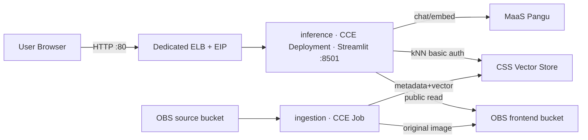

# automotive-damage-processing (Huawei Cloud Edition)

 

> Intelligent vehicle-damage assessment powered by generative AI. Semantic retrieval over historical damage cases produces a repair estimate.

## 1. Overview

A vehicle-damage assessment tool for insurers, repair shops, and fleet managers: users upload a damage photo and select parameters; the system uses a multimodal large model to generate standardized metadata, embeds the metadata into a vector, retrieves the most similar historical cases from a vector store, computes the mean repair estimate from the plain-text metadata of the Top-K matched cases, and finally displays the matched images together with a repair estimate breakdown.

- **Ingestion**: source image → multimodal model extracts metadata → text vector → written to the vector store; original image stored in the OBS display bucket.
- **Inference**: uploaded image + parameters → metadata → vector → kNN Top-K → mean cost → display.

## 2. Table of Contents

- [1. Overview](#1-overview)
- [2. Table of Contents](#2-table-of-contents)
- [3. Architecture Diagram](#3-architecture-diagram)
- [4. Highlights](#4-highlights)
- [5. Huawei Cloud Services Used](#5-huawei-cloud-services-used)
- [6. Prerequisites](#6-prerequisites)
- [7. Quick Start](#7-quick-start)
- [8. Step-by-Step Deployment](#8-step-by-step-deployment)
- [9. Usage and Verification](#9-usage-and-verification)
- [10. Cleanup Resources](#10-cleanup-resources)
- [11. Detailed Documentation](#11-detailed-documentation)
- [12. Dependencies](#12-dependencies)
- [13. FAQ / Troubleshooting](#13-faq--troubleshooting)
- [14. Contributing](#14-contributing)
- [15. License](#15-license)
- [16. Contact](#16-contact)
- [17. Maintainers](#17-maintainers)

## 3. Architecture Diagram



See [docs/architecture.md](docs/architecture.md) for details.

## 4. Highlights

- **Containerized + managed services**: CCE runs inference/ingestion, CSS hosts the vector store, SWR stores images — lightweight operations.
- **Unified model abstraction**: `src/adapter/model_adapter.py` converges chat/embedding into a unified interface, backed by the MaaS Pangu OpenAI-compatible endpoint; switch models by changing only a runtime config.
- **Controllable embedding strategy**: default text-only vectors (core estimation fully retained), multimodal embedding switched on with `MULTIMODAL_EMBEDDING=true`.
- **No CDN dependency**: the inference UI is served directly through the public ELB, and matched images are loaded from the public-read OBS bucket — suitable for intranet/trial use; for production you can switch to private access + signed URLs or add a CDN.

## 5. Huawei Cloud Services Used

| Service | Purpose |
|---------|---------|
| Dedicated ELB + EIP | Inference entry point |
| CCE (Cloud Container Engine) cluster + nodes | Container orchestration |
| CSS (Cloud Search Service, OpenSearch-compatible) | Vector store |
| OBS (Object Storage Service) | Image storage |
| MaaS (ModelArts Studio) Pangu | Model invocation |
| NAT Gateway + EIP | Private-network egress |
| LTS (Log Tank Service) | Logging |

## 6. Prerequisites

- A Huawei Cloud account with permissions to create VPC / ELB / CCE / CSS / OBS / SWR / IAM / LTS / ModelArts resources.
- Tools: Terraform ≥ 1.5 (huaweicloud provider 1.96.0), kubectl, docker, Huawei Cloud CLI (optional).
- Region: default `cn-north-4` (switching requires syncing `infra/variables.tf` and each image registry domain).
- A chat model (e.g. `pangu-nlp-2024-12`) and a text embedding model (e.g. `pangu-embedding-v1`) enabled in **ModelArts Studio (MaaS)**, with an API Key obtained.

## 7. Quick Start

```bash
# 1) Infrastructure
cd infra
export HW_ACCESS_KEY="<AK>" HW_SECRET_KEY="<SK>" HW_REGION_NAME="cn-north-4"
terraform init -input=false
terraform plan -out=tfplan     # review the resource list
terraform apply tfplan         # review the resource list before applying

# 2) Build and push images to SWR
cd ../src/containers/inference && ./build_and_push.sh cn-north-4 <your-project> damage-repo inference
cd ../ingestion && ./build_and_push.sh cn-north-4 <your-project> damage-repo ingestion

# 3) Fill k8s manifest placeholders, then deploy (see Step-by-Step Deployment)
kubectl apply -f ../inference/k8s/configmap.yaml
kubectl apply -f ../inference/k8s/secret.yaml
kubectl apply -f ../inference/k8s/deployment.yaml
kubectl apply -f ../inference/k8s/service.yaml
kubectl apply -f ../ingestion/k8s/job.yaml
```

## 8. Step-by-Step Deployment

Detailed command-level steps (credential preparation, placeholder filling, ingestion, and verification): [docs/deployment-guide.md](docs/deployment-guide.md).

## 9. Usage and Verification

1. Upload a damage source image to the OBS `source` bucket under the `repair-data/` prefix.
2. Watch `kubectl get job damage-ingestion` reach `1/1` Completed.
3. Open `http://<elb_eip>` in a browser (EIP is given by `terraform output elb_eip`).
4. Upload a damage image, select vehicle model / part / type / severity, and set the number of matches (max 3).
5. Expected: returns Top-K matched images, similarity scores, and an estimate explanation computed from the mean of the matched cases.

> If kNN reports an error, first verify that `EMBEDDING_DIM` matches the CSS index `dimension` (both values must stay in sync inside `k8s/configmap.yaml`).

> **Warning:** After deployment, please verify by following the steps in this section: upload a damage image and confirm that Top-K matched images and the estimate explanation are returned. The business function must be confirmed working before delivery is considered complete.

## 10. Cleanup Resources

```bash
kubectl delete -f src/containers/ingestion/k8s/job.yaml
kubectl delete -f src/containers/inference/k8s/service.yaml
kubectl delete -f src/containers/inference/k8s/deployment.yaml
kubectl delete -f src/containers/inference/k8s/secret.yaml
kubectl delete -f src/containers/inference/k8s/configmap.yaml
cd infra && terraform destroy -input=false   # release all cloud resources
```

## 11. Detailed Documentation

- Architecture and components: [docs/architecture.md](docs/architecture.md)
- Deployment and operations: [docs/deployment-guide.md](docs/deployment-guide.md)
- Model response / embedding / index constraints: see `EMBEDDING_DIM` / `CHAT_MODEL` / `EMBEDDING_MODEL` in `src/containers/{inference,ingestion}/k8s/configmap.yaml` — these three values must stay consistent with the selected MaaS model's output dimension.

## 12. Dependencies

- `openai` (MaaS OpenAI-compatible endpoint), `opensearch-py` (CSS vector store), `esdk-obs-python` (OBS), `streamlit`, `Pillow`, `requests`.
- Dataset from [Roboflow car-damage-images](https://universe.roboflow.com/car-damage-kadad/car-damage-images/).

## 13. FAQ / Troubleshooting

- **kNN dimension mismatch**: `EMBEDDING_DIM` must equal the selected embedding model's output dimension, and the CSS index `dimension` must match it.
- **Image pull failure**: confirm the SWR organization name in the manifests has been replaced with `<your-project>`, and that the node Agency has `SWR FullAccess`.
- **Inference UI inaccessible**: confirm `service.yaml`'s `kubernetes.io/elb.id` holds the real ELB ID, and that the security group allows inbound 80/443/8501.
- **CSS authentication failure**: `OS_USER` defaults to `admin`, and the password is `css_password` passed via `terraform.tfvars`; it is injected through a Secret — do not commit it in plaintext.

## 14. Contributing

Please submit feedback and improvement suggestions via Issue. Direct PRs are not accepted; all changes are unified and merged after maintainer review. Before submitting, ensure `terraform fmt` and `terraform validate` pass and that no real credentials are included. See [CONTRIBUTING.md](CONTRIBUTING.md) for the contribution workflow.

## 15. License

- This repository is released under the **MIT-0 (MIT No Attribution)** license; the full license text is in [LICENSE](LICENSE).
- MIT-0 is a permissive license with no attribution requirement.

## 16. Contact

- Issue feedback: submit via repository Issue; for internal collaboration contact the maintainer.

## 17. Maintainers

| Role | Account |
|------|---------|
| **Creator** | [@dengguicai](https://github.com/dengguicai) |
| **Maintainer** | [@dengguicai](https://github.com/dengguicai) |
