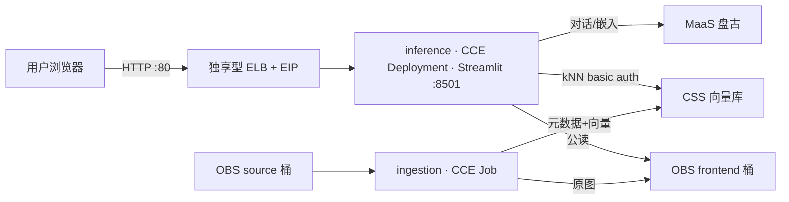

# automotive-damage-processing（华为云版）

 

> 车辆损伤智能估价 · 生成式 AI 方案。基于历史损伤案例的语义检索，给出损伤维修估价。

## 1. 简介

一套面向保险机构、维修厂、车队管理者的车辆损伤估价工具：用户上传损伤图片并选择参数，系统通过多模态大模型生成标准化元数据、对元数据做向量嵌入，在向量库中检索最相似的历史案例，并基于 Top-K 匹配案例的明文元数据计算维修估价均值，最终展示匹配图与估价说明。

- **灌库（ingestion）**：源图 → 多模态模型抽取元数据 → 文本向量 → 写入向量库；原图存 OBS 展示桶。
- **推理（inference）**：上传图 + 参数 → 元数据 → 向量 → kNN Top-K → 均价 → 展示。

## 2. 目录

- [1. 简介](#1-简介)
- [2. 目录](#2-目录)
- [3. 架构图](#3-架构图)
- [4. 方案亮点](#4-方案亮点)
- [5. 涉及云服务](#5-涉及云服务)
- [6. 前置条件](#6-前置条件)
- [7. 快速开始](#7-快速开始)
- [8. 分步部署](#8-分步部署)
- [9. 使用方法与验证](#9-使用方法与验证)
- [10. 清理资源](#10-清理资源)
- [11. 详细说明](#11-详细说明)
- [12. 依赖](#12-依赖)
- [13. FAQ / 故障排除](#13-faq--故障排除)
- [14. 贡献指南](#14-贡献指南)
- [15. 许可证](#15-许可证)
- [16. 联系方式](#16-联系方式)
- [17. 维护者信息](#17-维护者信息)

## 3. 架构图



详见 [docs/architecture.md](docs/architecture.md)。

## 4. 方案亮点

- **容器化 + 托管服务**：CCE 跑推理/灌库，CSS 托管向量库，SWR 存镜像，运维轻。
- **统一模型抽象**：`src/adapter/model_adapter.py` 把对话/嵌入收敛为统一接口，底层走 MaaS 盘古 OpenAI 兼容端点，切换模型仅改环境变量。
- **嵌入策略可控**：默认仅文本向量（完整保留核心估价能力），多模态嵌入经 `MULTIMODAL_EMBEDDING=true` 一键切换。
- **无 CDN 依赖**：推理 UI 经 ELB 公网直出，匹配图 OBS 公读加载，适合内网/试用；生产可改私有 + 签名 URL 或套 CDN。

## 5. 涉及云服务

| 服务 | 用途 |
|------|------|
| 独享型 ELB + EIP | 推理入口 |
| CCE 集群 + 节点 | 容器编排 |
| CSS（OpenSearch） | 向量库 |
| OBS | 图片存储 |
| MaaS 盘古 | 模型调用 |
| NAT + EIP | 私网出网 |
| LTS | 日志 |

## 6. 前置条件

- 华为云账号，具备 VPC / ELB / CCE / CSS / OBS / SWR / IAM / LTS / ModelArts 创建权限。
- 工具：Terraform ≥ 1.5（huaweicloud provider 1.96.0）、kubectl、docker、华为云 CLI（可选）。
- 区域：默认 `cn-north-4`（切换需同步改 `infra/variables.tf` 与各镜像仓库域名）。
- 已在 **ModelArts Studio（MaaS）** 开通对话模型（如 `pangu-nlp-2024-12`）与文本嵌入模型（如 `pangu-embedding-v1`），并取得 API Key。

## 7. 快速开始

```bash
# 1) 基础设施
cd infra
export HW_ACCESS_KEY="<AK>" HW_SECRET_KEY="<SK>" HW_REGION_NAME="cn-north-4"
terraform init -input=false
terraform plan -out=tfplan     # 确认资源清单
terraform apply tfplan         # ⚠️ apply 前请确认资源清单

# 2) 构建镜像到 SWR
cd ../src/containers/inference && ./build_and_push.sh cn-north-4 <your-project> damage-repo inference
cd ../ingestion && ./build_and_push.sh cn-north-4 <your-project> damage-repo ingestion

# 3) 填 k8s 清单占位符后部署（见分步部署）
kubectl apply -f ../inference/k8s/configmap.yaml
kubectl apply -f ../inference/k8s/secret.yaml
kubectl apply -f ../inference/k8s/deployment.yaml
kubectl apply -f ../inference/k8s/service.yaml
kubectl apply -f ../ingestion/k8s/job.yaml
```

## 8. 分步部署

详细命令级步骤（含凭据准备、占位符填充、灌库与验证）：[docs/deployment-guide.md](docs/deployment-guide.md)。

## 9. 使用方法与验证

1. 向 OBS `source` 桶 `repair-data/` 前缀上传损伤源图。
2. 观察 `kubectl get job damage-ingestion` 达 `1/1` 完成。
3. 浏览器访问 `http://<elb_eip>`（EIP 由 `terraform output elb_eip` 给出）。
4. 上传一张损伤图、选择车型/部位/类型/严重度、设定匹配数（最多 3）。
5. 预期：返回 Top-K 匹配图、相似度分数与由匹配案例均值计算的估价说明。

> 若 kNN 报错，先核对 `EMBEDDING_DIM` 与 CSS 索引 `dimension` 是否一致（两者必须在 `k8s/configmap.yaml` 中保持相同）。

> ⚠️ 部署完成后请按本节步骤自行验证：上传一张损伤图、确认返回 Top-K 匹配图与估价说明，业务功能可用后方可视为交付完成。

## 10. 清理资源

```bash
kubectl delete -f src/containers/ingestion/k8s/job.yaml
kubectl delete -f src/containers/inference/k8s/service.yaml
kubectl delete -f src/containers/inference/k8s/deployment.yaml
kubectl delete -f src/containers/inference/k8s/secret.yaml
kubectl delete -f src/containers/inference/k8s/configmap.yaml
cd infra && terraform destroy -input=false   # 释放全部云资源
```

## 11. 详细说明

- 架构与组件：[docs/architecture.md](docs/architecture.md)
- 部署与运维：[docs/deployment-guide.md](docs/deployment-guide.md)
- 模型响应 / 嵌入 / 索引约束的取值见 `src/containers/{inference,ingestion}/k8s/configmap.yaml` 中的 `EMBEDDING_DIM` / `CHAT_MODEL` / `EMBEDDING_MODEL`，三者需与所选 MaaS 模型实际输出维度保持一致

## 12. 依赖

- `openai`（MaaS OpenAI 兼容端点）、`opensearch-py`（CSS 向量库）、`esdk-obs-python`（OBS）、`streamlit`、`Pillow`、`requests`。
- 数据集来自 [Roboflow car-damage-images](https://universe.roboflow.com/car-damage-kadad/car-damage-images/)。

## 13. FAQ / 故障排除

- **kNN 维度不匹配**：`EMBEDDING_DIM` 必须等于所选嵌入模型输出维度，且 CSS 索引 `dimension` 与之相同。
- **镜像拉取失败**：确认 SWR 组织名已替换清单中的 `<your-project>`，且节点 Agency 有 `SWR FullAccess`。
- **推理 UI 无法访问**：确认 `service.yaml` 的 `kubernetes.io/elb.id` 已填真实 ELB ID，且安全组入站放通 80/443/8501。
- **CSS 鉴权失败**：`OS_USER` 默认 `admin`，密码为 `terraform.tfvars` 传入的 `css_password`；通过 Secret 注入，勿明文。

## 14. 贡献指南

请通过 Issue 提交反馈与改进建议；本仓库不接受直接 PR，统一由维护者评审后合入。提交前请确保 `terraform fmt` 与 `terraform validate` 通过，且不含任何真实凭据。贡献流程详见 [CONTRIBUTING.md](CONTRIBUTING.md)。

## 15. 许可证

- 本仓库以 **MIT-0（MIT No Attribution）** 许可证发布，许可证全文见 [LICENSE](LICENSE)。
- MIT-0 为宽松协议，无署名保留义务。

## 16. 联系方式

- 问题反馈：请通过本仓库 Issue 提交；内部协作请联系维护者。

## 17. 维护者信息

| 角色 | 账号 |
|------|------|
| **创建者** | [@dengguicai](https://github.com/dengguicai) |
| **维护者** | [@dengguicai](https://github.com/dengguicai) |
