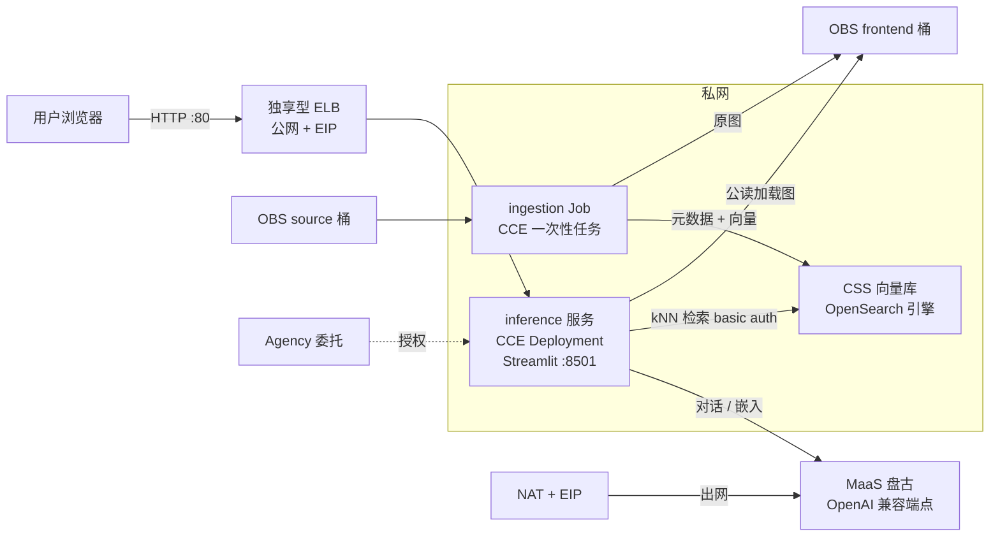

# 架构总览 — automotive-damage-processing

> 华为云版「车辆损伤智能估价」生成式 AI 方案：基于历史损伤案例的语义检索，给出维修费用估价。

## 业务模式

本方案属于「多模态语义检索 / RAG」模式，分两个阶段：

- **灌库（ingestion）**：损伤图片 → 多模态大模型抽取标准化元数据 → 文本向量嵌入 → 写入向量库；原图存入 OBS 展示桶。
- **推理（inference）**：用户上传损伤图 + 选参数 → 多模态模型生成元数据 → 文本向量嵌入 → 向量库 kNN 取 Top-K 相似案例 → 按 Top-K 明文元数据算均价 → 展示匹配图与估价。

核心业务价值 = 基于历史损伤案例的语义估价，匹配主要由「元数据文本相似度」驱动，图像用于前端展示。

## 架构图



## 组件清单

| 层 | 华为云服务 | 作用 |
|----|-----------|------|
| 网络 | VPC / 子网 / 安全组 / NAT / EIP | 网络底座；公网入口经 ELB 绑 EIP，私网经 NAT 出网访问 MaaS/CSS/OBS 公网端点 |
| 负载均衡 | 独享型 ELB | 推理 UI 公网入口 HTTP:80 → 容器 8501 |
| 容器编排 | CCE 集群 + 节点池 | 推理 Deployment（常驻）+ 灌库 Job（一次性） |
| 镜像仓库 | SWR | 存放 inference / ingestion 镜像 |
| 向量库 | CSS（OpenSearch 引擎） | kNN 向量检索，HNSW + L2 |
| 对象存储 | OBS ×2 桶 | frontend 公读展示图 / source 灌库源图 |
| 模型 | MaaS（ModelArts Studio）盘古 | 多模态对话 + 文本嵌入 |
| 日志 | LTS | 收集容器日志 |
| 权限 | IAM Agency 委托 | 节点 / 工作负载访问 OBS / SWR / ModelArts / VPC |

## 关键设计决策

1. **默认仅文本向量**：不使用图像+文本联合嵌入，对元数据做文本嵌入。匹配退化为元数据语义相似度，完整保留核心估价能力；多模态嵌入经 `MULTIMODAL_EMBEDDING=true` 可切换。
2. **不部署 CDN**：推理 UI 直接经 ELB 公网直出，匹配图从 OBS 公读加载。生产建议改为 OBS 私有 + 临时签名 URL 或套 CDN + 鉴权。
3. **CSS 自建集群**：采用托管 OpenSearch 集群承载向量库，接口兼容 opensearch-py，鉴权走 HTTP basic auth。
4. **配置下发**：参数存储采用 CCE ConfigMap / Secret，运行时由容器环境变量读取。
5. **单一 Agency**：多 IAM 角色收敛为单一委托 + 工作负载凭据 Secret。

## 目录结构

```
automotive-damage-processing/
├── docs/                      # 架构说明 / 部署指导
├── infra/                     # Terraform + huaweicloud Provider
└── src/
    ├── adapter/               # OBS / OpenSearch / 模型抽象层（model_adapter）
    └── containers/
        ├── inference/         # Streamlit 推理服务（Dockerfile / k8s / 构建脚本）
        └── ingestion/         # 一次性灌库任务（Dockerfile / k8s / 构建脚本）
```
